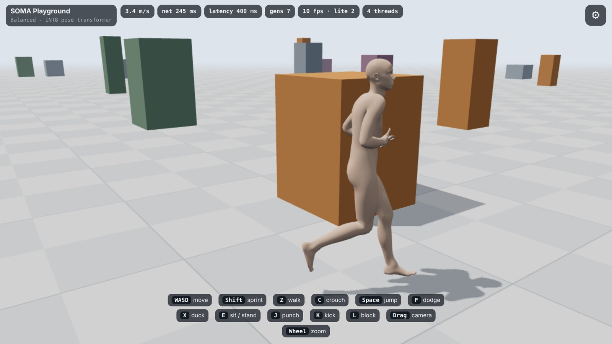
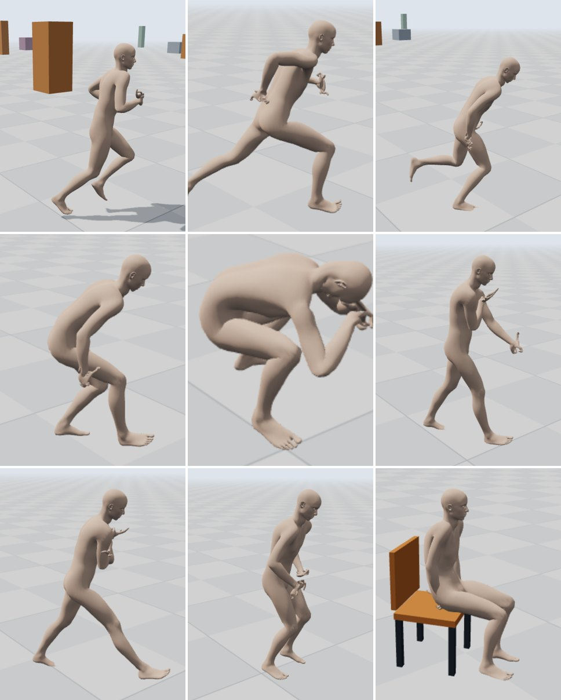
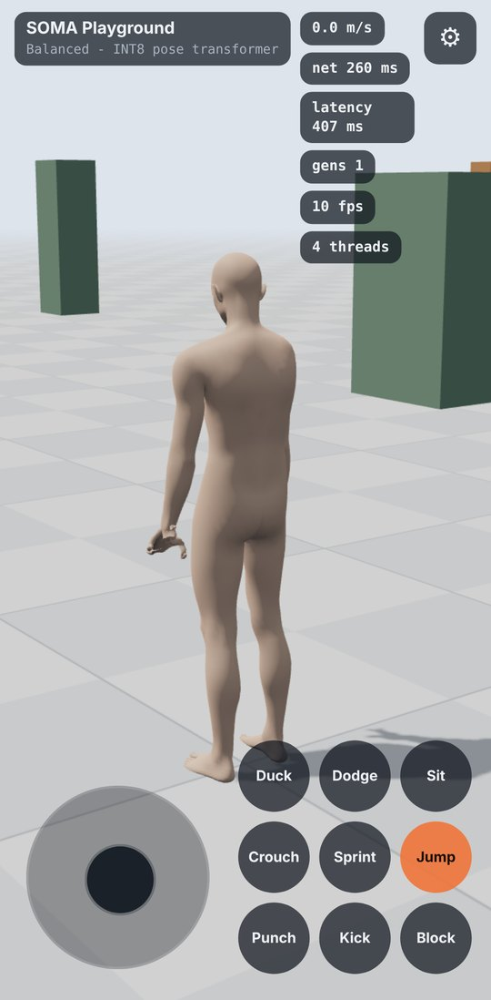

# MotionBricks V2: a neural character controller in your browser

**[▶ Play the demo](https://project-debugger.github.io/MotionBricks-V2/)**: phone or desktop, no install, no GPU.



Every step, turn, jump and stop you see is **generated live by a neural network**, NVIDIA's
[MotionBricks](https://huggingface.co/nvidia/MotionBricks) **SOMA** human-motion model. It runs **on your own
device** in WebAssembly, with no server and no GPU. There are no animation clips playing back: the page shows the
network the last few poses and where you want to go, and it writes the next second of motion. Real motion capture
is only used to give the network targets (what a stride or a jump looks like).

This repository makes that practical in a browser and on a phone:

- **150 MB model**: the 760 MB FP32 network becomes an INT8 network stored 5.5-bit (ggml Q5_0) in a split GGUF
  file, the same accuracy on held-out motion (joint error 7.1 cm vs 7.0 cm for FP32), cached after the first visit.
- **AI only, by default**: what you see is the network's own motion. The controller only says where to go (a target
  pose from motion capture, placed along your path); the network picks the timing, so speed, stride and weight shifts
  are its own, as in NVIDIA's MotionBricks demos. Starts and stops are instant because they jump into motion the same
  network generated ahead of time; only joint limits and upstream's endpoint correction are applied on top.
- **Game-feel presets** (Shooter, Responsive, Balanced, Smooth) add what games usually add: instant transitions
  pre-generated by the same network, steering, foot locking, leaning into turns, joint limits, procedural fingers,
  muscles, breathing and soft tissue.
- **Runs on weak hardware**: the network runs on a worker thread (1–4 threads); the page adapts resolution and shadows
  to hold the frame rate. Main-thread cost: about 1.3 ms per frame.
- **Freely licensed motion targets**: walking from 100STYLE (CC BY 4.0) and running, crouching, jumping,
  sitting, ducking and dodging from the CMU Motion Capture Database (free for all uses), retargeted onto the SOMA
  rig. Nothing from NVIDIA's evaluation-only sample clips is included.

<p align="center">
  
  &nbsp;
  
</p>

## Controls

| Phone | Desktop | |
|---|---|---|
| Left joystick (push far to run) | `WASD` / arrows | Move (camera-relative) |
| Sprint | `Shift` | Sprint |
| | `Z` | Walk / run toggle |
| Crouch | `C` | Crouch walk |
| Jump · Duck · Dodge | `Space` · `X` · `F` | Actions |
| Punch · Kick · Block | `J` · `K` · `L` | Fighting |
| Sit | `E` | Sit on a chair / stand up |
| Drag | Drag, wheel | Camera, zoom |

The ⚙ panel has walk styles (proud, strutting, rushed, sad, elderly, hands behind back: real 100STYLE motion),
presets, speeds, responsiveness and every quality pass as a toggle.

## How it works

```
 you ──► controller ──► target pose window ──► SOMA network (worker, WASM) ──► decode ──► clean-up ──► skinned mesh
           │  (where to be in ~1 s,             (4 past poses + target          (endpoint & velocity
           │   human acceleration)                → next 0.5–2 s of motion)      matching, joint limits,
           └── instant transition bank ─────────────────────────────────────────► foot locking, fingers)
```

1. The **controller** plans a path with human acceleration limits and picks a target window from real motion
   capture that matches the speed, turn and stride phase the character is in.
2. The **network** (onnxruntime-web, INT8, 1–4 WebAssembly threads) generates the motion from the current
   poses to that target; results are spliced into the playing buffer before it runs out.
3. The **transition bank** (11k frames of the same network's output, 2.9 MB) covers the first moments of every start,
   stop, turn and action, so input never waits for the network.
4. **Clean-up passes** remove the usual artefacts of generated motion; the body layer adds what the network has no data
   for (fingers, muscles, breathing).

Details: [site/README.md](site/README.md) (the web runtime), [docs/](docs/) (the Python runtime, optimization,
configuration).

## Run it locally

```bash
cd site && node build/serve.mjs 8123 --isolate     # then open http://localhost:8123
```

`--isolate` sends the headers that enable multi-threaded WebAssembly; on GitHub Pages `coi-serviceworker.js` does
the same. Everything the page needs is in `site/` (186 MB, of which the model is 150 MB).

### Host it on GitHub Pages

`.github/workflows/pages.yml` publishes `site/` on every push to `main` (or the development branch) that touches it.
Once: **Settings → Pages → Build and deployment → Source: GitHub Actions**. The repository must be public (or on a
plan with private Pages). If the deploy step says the branch is not allowed, add it under **Settings → Environments
→ github-pages → Deployment branches**, or deploy from `main`.

## Rebuild everything

| What | Command | Needs |
|---|---|---|
| Model (ONNX → INT8 → split GGUF) | `tools/download_soma.py`, `tools/export_onnx.sh`, `tools/optimize_models.py`, `tools/build_web_models.py`, `tools/gguf/build_gguf.py` | the NVIDIA checkpoint (downloaded and hash-verified) |
| Motion capture | `python3 -I tools/mocap/style100.py fetch && … retarget`; `python3 -I tools/mocap/cmu.py fetch && … retarget` | network access (100STYLE from Zenodo, CMU from mocap.cs.cmu.edu) |
| Targets, clips, actions, joint limits | `.venv/bin/python tools/export_web_data.py` | the retargeted clips |
| Network hinge axes | `node site/build/tools/gen_bank.cjs 8123 0 --raw` then `tools/fit_hinges.py` | the dev server running |
| Transition bank | `node site/build/tools/gen_bank.cjs 8123` | the dev server running |
| Body mesh | `tools/extract_mesh.py` | the upstream SOMA rig (`tools/fetch_upstream.py`) |
| Tests | `.venv/bin/python -m pytest -q` | `tools/setup_env.sh` |

Retargeting: each source rig's joint rotations are copied onto a calibrated SOMA T-pose, the pelvis follows the
performer's hip sockets scaled by leg length, feet stay flat, and the arms are re-solved with two-bone IK so the
elbows bend about the network's own hinge axis (`tools/mocap/`).

## Python runtime

`runtime/somart` is the same pipeline in NumPy for games and tools outside the browser: single, batched and
asynchronous generation, any onnxruntime execution provider, a real-time controller, YAML configuration and
presets. Setup: `bash tools/setup_env.sh`, `python3 tools/download_soma.py`, `bash tools/export_onnx.sh`. Its
clip library reads the upstream MotionBricks sample clips (`tools/fetch_upstream.py --groups rig,motions`), which
NVIDIA licenses for evaluation only and which are therefore not part of this repository. See
[docs/ARCHITECTURE.md](docs/ARCHITECTURE.md) and [docs/CONFIGURATION.md](docs/CONFIGURATION.md).

Measured on a 4-vCPU Xeon without GPU (onnxruntime 1.32): INT8 pose transformer 56 ms per generation on 4 threads
(FP32: 79 ms), half the RAM (671 vs 1316 MB), 98.9 % same motion duration as FP32; velocity-matched joins and
foot locking cut foot sliding 37 % and join pops 40–49 % ([docs/OPTIMIZATION.md](docs/OPTIMIZATION.md),
[docs/ANIMATION.md](docs/ANIMATION.md)).

## Repository layout

```
site/            the playable demo: index.html, js/ (runtime, controller, renderer), data/ (motion targets,
                 transition bank, joint limits, body mesh), models/ (the split GGUF network), vendor/, build/ (dev
                 server, bank generator, simulation tests)
tools/           model download/export/quantization, GGUF packing, mocap fetch + retargeting, data export
runtime/somart/  Python runtime (engine, codec, controller, configuration)
configs/         YAML defaults, presets, skeleton profile, joint limits, hinge axes
models/soma/     checksums and manifests (the weights themselves are downloaded, not committed)
tests/           pytest suite
docs/            architecture, optimization, animation, configuration, training, limitations
```

## Limitations

- Human only: SOMA is a 30-joint human model. (Animals moved to a separate project.)
- Sprinting (5.5 m/s) is faster than any capture in the free data (up to 4.5 m/s): the network extrapolates.
- 100STYLE's crouch is a stoop, so crouch walking comes from one CMU performer; there is no deep crouch.
- The first visit downloads 150 MB; generation takes 0.15–0.3 s per call on a laptop CPU, longer on old phones
  (the transition bank and planning ahead hide most of it).
- More in [docs/LIMITATIONS.md](docs/LIMITATIONS.md).

## Credits and licences

- **SOMA model weights**: NVIDIA, [NVIDIA Open Model License](https://www.nvidia.com/en-us/agreements/enterprise-software/nvidia-open-model-agreement/).
  The demo runs a quantized derivative. **SOMA body mesh**: NVIDIA, CC BY 4.0.
- **Motion capture**: 100STYLE by Ian Mason, Sebastian Starke and Taku Komura, CC BY 4.0
  ([doi:10.5281/zenodo.8127870](https://doi.org/10.5281/zenodo.8127870)). The data used in this project was
  obtained from [mocap.cs.cmu.edu](http://mocap.cs.cmu.edu); the database was created with funding from NSF
  EIA-0196217. Both retargeted onto the SOMA rig.
- **Upstream code**: parts of `runtime/somart` are ports of Apache-2.0 MotionBricks code; see [NOTICE](NOTICE).
- **Web runtime**: onnxruntime-web, three.js, coi-serviceworker (MIT).
- **This repository's own code** has no licence file yet, so all rights are reserved by default. Add a `LICENSE` (for
  example Apache-2.0, matching the upstream code) to let others reuse it.
